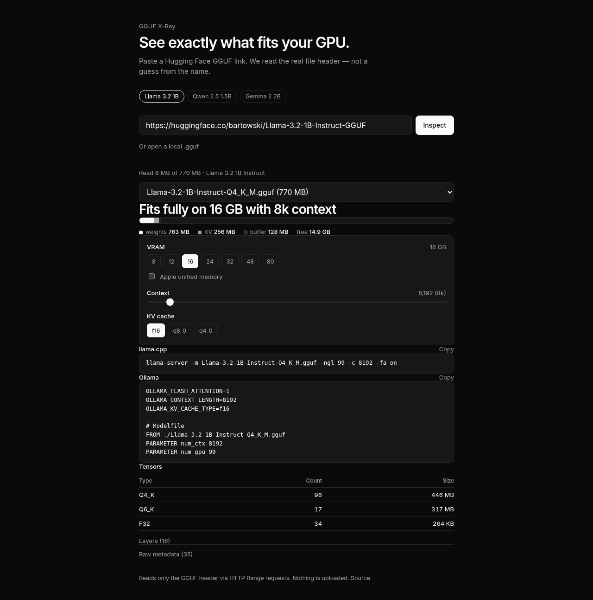

# GGUF X-Ray

**Can my computer run this AI model?**

Paste a Hugging Face GGUF link or choose from curated models. See exactly what fits your GPU, estimated generation speed in tokens/second, and get copy-paste commands — read directly from the real file header, not guessed from the model name.

**Live:** https://gfxroy.github.io/gguf-xray/



---

## Features

- **Hardware Library & Detection:**
  - Searchable catalog of popular GPUs and Macs: NVIDIA GeForce RTX 20 / 30 / 40 / 50 series, Apple Silicon M1–M4 variants with unified memory, AMD Radeon RX 6000 / 7000, Intel Arc, and CPU DDR4/DDR5 fallbacks.
  - **"Auto-detect" button:** Uses WebGPU adapter information and `navigator.deviceMemory` for instant hardware discovery, with a clear explanation of browser privacy sandboxing.
  - Custom hardware drawer for custom VRAM, system RAM, memory bandwidth, and Apple unified memory rules.
- **Curated Models & Custom Links:**
  - One-click presets for popular modern models: Llama 3.x (1B, 3B, 8B, 70B), Qwen 2.5 & Coder (1.5B, 7B, 14B), Gemma 2 (2B, 9B), Mistral 7B v0.3, Phi 3.5 Mini, and DeepSeek R1 distills (Qwen 1.5B/7B/14B, Llama 8B) verified against active Hugging Face repositories.
  - Paste any Hugging Face repo ID or direct `.gguf` URL, or inspect a local `.gguf` file using `Blob.slice`.
- **Instant Human Verdict:**
  - Clear, jargon-free verdict: **Runs great**, **Runs slowly**, or **Won't fit**.
  - Key metrics: Estimated tokens/sec, best quantization tier for your device, maximum context length, and exact GPU layer offload ratio.
  - Sleek memory visualizer bar showing weights, KV cache, compute buffer, and free headroom.
- **Side-by-Side Quantization Comparison:**
  - Compares every quantization in the repository (or standard tiers Q2_K through Q8_0): file size, hardware fit, estimated generation speed, and quality tradeoffs.
  - One-click button to inspect any quant directly from the table.
- **Ready-to-Run Commands:**
  - **Ollama:** `ollama run <tag>` and copy-ready `Modelfile` with preconfigured `num_gpu` and `num_ctx`.
  - **LM Studio:** Recommended GPU offload layers, context length, and Flash Attention settings.
  - **llama.cpp:** Pre-tuned `llama-server` and `llama-cli` commands with `-ngl`, `-c`, `-fa on`, and `-ctk`/`-ctv` flags.
- **Shareable Result Links:**
  - Encodes device, model, quantization, context length, and KV cache settings into the URL hash (`#dev=...&m=...&ctx=...`). Restores state on load and provides an instant "Share result" copy button.
- **Collapsible Expert Breakdown:**
  - Tensor datatype counts and byte sizes.
  - Repeating layer blocks (`blk.0` ... `blk.N`) with GPU vs. CPU placement.
  - Raw metadata key-value explorer with live filtering.
  - Network audit reporting exact HTTP Range request bytes read vs. total weight size.

---

## How It Works

### 1. Header, Not the Weights
A GGUF file begins with a typed header (magic number `GGUF`, version, key-value metadata, tensor names, dimensions, types, and offsets) followed by an aligned binary weight blob. The header of a 7B model is typically only 1–3 MB.

X-Ray makes an HTTP Range request for the first 2 MB. If the header extends further, the parser throws a typed `NeedMoreBytes` exception with the required byte offset, and the loader fetches the required range. The multi-gigabyte weight blob is never downloaded. Local files use the browser's `Blob.slice` API identically.

### 2. Speed Estimation Formula (Memory Bandwidth)
Autoregressive token generation (batch size 1) is memory-bandwidth bound: each generated token requires reading the active model weights from memory into the compute units.

$$\text{Tokens/sec} = \frac{\text{Memory Bandwidth (bytes/s)} \times \eta}{\text{Active Weights} + \text{KV Cache Size}}$$

- **100% GPU / Unified Memory:**
  $$\text{tok/s} = \frac{BW_{\text{GPU}} \times 0.75}{W_{\text{GPU}} + KV_{\text{context}}}$$
  $\eta = 0.75$ models real-world memory efficiency for optimized CUDA and Metal kernels.
- **Partial Offload:**
  When weights are split between GPU VRAM and CPU RAM, generation must wait for both memory buses, plus a ~8ms PCIe host-device synchronization penalty per token:
  $$T_{\text{token}} = \frac{W_{\text{GPU}}}{BW_{\text{GPU}} \times 0.75} + \frac{W_{\text{CPU}}}{BW_{\text{CPU}} \times 0.65} + T_{\text{PCIe}}$$
  $$\text{tok/s} = \frac{1}{T_{\text{token}}}$$
- **CPU Only:**
  Uses dual-channel DDR4 (~35 GB/s) or DDR5 (~60 GB/s) system memory bandwidth with $\eta = 0.65$.

### 3. Architecture-Aware Memory Model
Metadata keys parsed from the header determine model geometry:
- `{arch}.block_count` — total transformer layers.
- `context_length` — maximum training context.
- `embedding_length`, `attention.head_count`, `attention.head_count_kv` — KV cache dimensions.
- Multi-Latent Attention (MLA) for DeepSeek architectures: models compressed latent rank (`kv_lora_rank` + RoPE dimension) rather than standard head projection.
- Sliding window attention (e.g., Gemma 2): calculates token memory based on window patterns.

### 4. Compute Buffer
With Flash Attention (`-fa on`), llama.cpp sizes the ggml graph allocator to the largest intermediate activation (the feed-forward network scratch), avoiding an $n_{\text{ctx}}^2$ attention score matrix:

$$\text{Buffer} = 64\text{ MiB graph overhead} + 4 \times n_{\text{ff}} \times 512 \times 4\text{ bytes}$$

For Mixture-of-Experts (MoE), $n_{\text{ff}}$ uses $\text{expert\_feed\_forward\_length} \times \text{expert\_used\_count}$.

---

## Limitations

- A small number of CDNs do not honor HTTP `Range` headers; in those cases, the stream is aborted once the header is read.
- Gated or private Hugging Face repositories require authentication tokens, which this tool does not ask for. Download the file and use the local file picker instead.
- Big-endian GGUF v3 is not implemented (virtually all public community models are little-endian).
- Compute buffer and runtime driver overhead are close approximations ($\pm 20\%$).

---

## Development

```bash
# Install dependencies
npm install

# Start local Vite development server
npm run dev

# Run Vitest test suite
npm test

# Run ESLint and TypeScript check
npm run lint
npm run typecheck

# Build for production
npm run build

# Build for GitHub Pages
npm run build:pages
```

Built with React 19, TypeScript, Vite, and Vitest. Deployed to GitHub Pages via GitHub Actions.

---

## License

MIT © Aaditya Roy
